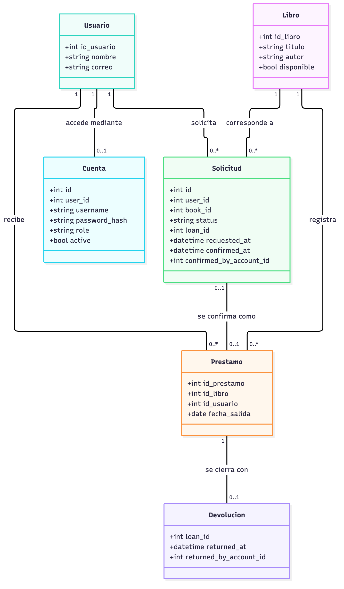
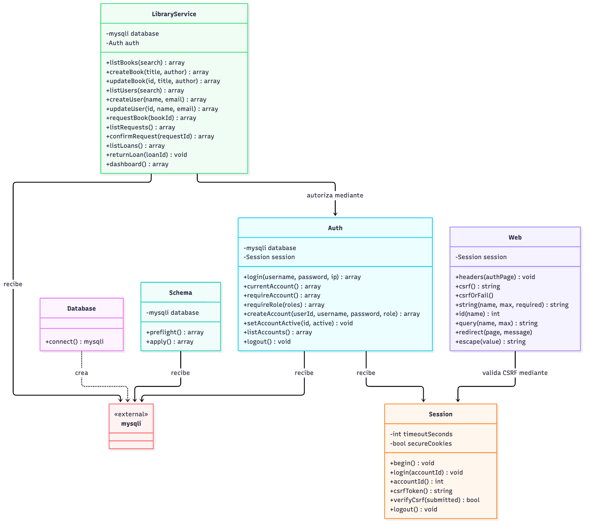

# Taller 1.3 — Biblioteca académica

La entrega identifica entidades, atributos, métodos y relaciones, y explica su correspondencia con la aplicación web actual.

## Leer en este orden

1. [Informe y decisiones](Taller_1.3_Analisis_Estatico_UML.md).
2. Modelo conceptual: entidades y multiplicidades, no clases PHP inventadas.
3. Clases PHP: servicios, autenticación, sesión, infraestructura y límite HTTP.
4. [Esquema documental](schema.sql) y [migración segura](../../docs/migration.md).

## Modelo de dominio

Fuente editable: [diagrama_dominio.mmd](diagrama_dominio.mmd).

## Clases PHP implementadas

Fuente editable: [diagrama_codigo.mmd](diagrama_codigo.mmd).

## Código y comprobaciones

- [Inicio del proyecto](../../README.md): configuración y ejecución.
- [Arquitectura](../../docs/architecture.md): responsabilidades y decisiones.
- [Verificación y límites](../../docs/verification.md): pruebas observadas y evidencia no disponible.

Los PNG se generan desde los archivos Mermaid locales. Los bloques del informe deben coincidir con sus fuentes `.mmd`. `schema.sql` documenta las siete tablas; no sustituye el preflight del CLI ni autoriza cambios en una base real.

La implementación actual no conserva clases PHP individuales `Libro`, `Usuario` y `Prestamo`: son entidades del modelo conceptual y sus operaciones están centralizadas en `LibraryService`. La distinción es intencional.
