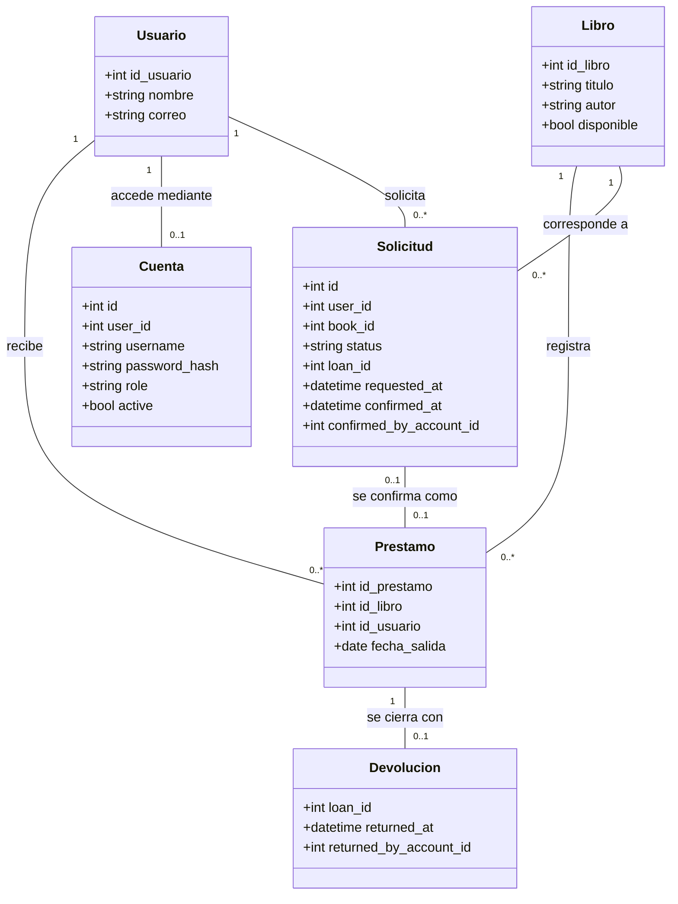
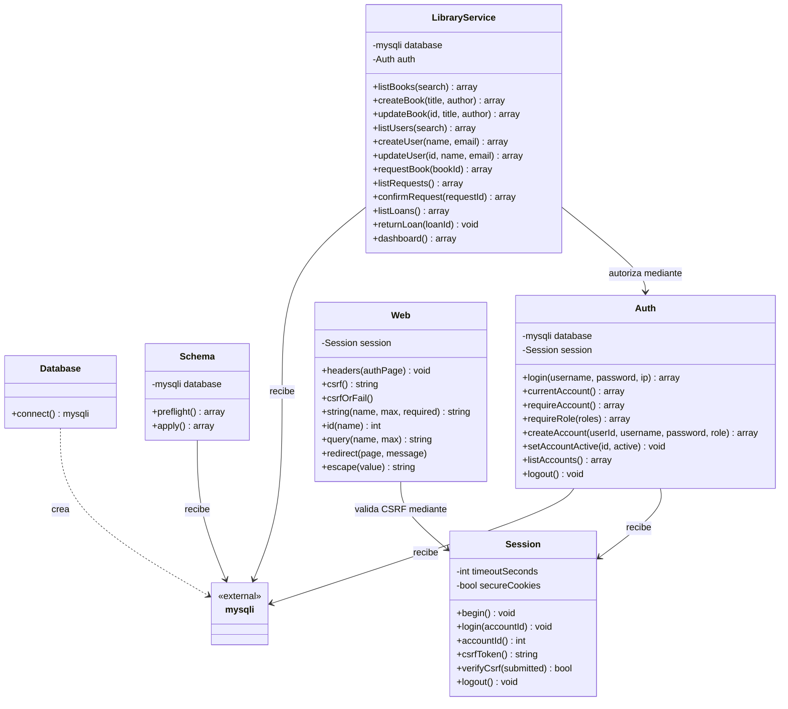

# Taller 1.3 — Análisis estático y modelado UML de una biblioteca

**Asignatura:** Diseño y Arquitectura de Software.
**Alcance:** modelo de dominio, clases PHP reales, relaciones y decisiones de la aplicación web implementada.

## 1. Objetivo y problema

> “Una biblioteca necesita un sistema para registrar libros, usuarios y préstamos.”

Mi objetivo es representar la estructura del sistema con UML y relacionarla con una implementación verificable. La biblioteca permite consultar el catálogo, gestionar libros y usuarios, solicitar préstamos, confirmar su entrega y registrar devoluciones. El lector solicita; el bibliotecario o administrador confirma y devuelve. Solo el administrador aprovisiona cuentas de acceso.

## 2. Entidades, atributos y métodos

### Modelo del dominio

| Entidad | Atributos principales | Responsabilidad |
|---|---|---|
| `Libro` | `id_libro`, `titulo`, `autor`, `disponible` | Identificar una obra o ejemplar del catálogo |
| `Usuario` | `id_usuario`, `nombre`, `correo` | Identificar a la persona de la biblioteca |
| `Prestamo` | `id_prestamo`, `id_libro`, `id_usuario`, `fecha_salida` | Conservar la asignación y fecha de entrega |
| `Cuenta` | `id`, `user_id`, `username`, `password_hash`, `role`, `active` | Autenticar y determinar permisos |
| `Solicitud` | `id`, `user_id`, `book_id`, `status`, `loan_id`, fechas y actor de confirmación | Separar una petición de la entrega física |
| `Devolucion` | `loan_id`, `returned_at`, `returned_by_account_id` | Cerrar un préstamo una sola vez sin borrar su historia |

Estos nombres son **entidades conceptuales**, no clases PHP que se deban inventar en el diagrama del código. Sus datos se almacenan en `libros`, `usuarios`, `prestamos`, `accounts`, `loan_requests` y `loan_returns`. `auth_attempts` es infraestructura de limitación de intentos de acceso, no una entidad central de la biblioteca.

### Clases y métodos realmente implementados

| Clase PHP | Dependencias/atributos | Métodos públicos representativos |
|---|---|---|
| `Database` | Configuración del entorno | `connect()` |
| `Schema` | `database: mysqli` | `preflight()`, `apply()` |
| `Session` | Tiempo de inactividad, cookies seguras, reloj | `begin()`, `login()`, `accountId()`, `csrfToken()`, `verifyCsrf()`, `logout()` |
| `Auth` | `database`, `session`, reloj y límites de intentos | `login()`, `currentAccount()`, `requireRole()`, `createAccount()`, `setAccountActive()`, `listAccounts()` |
| `LibraryService` | `database`, `auth` | `createBook()`, `updateBook()`, `listBooks()`, `createUser()`, `updateUser()`, `listUsers()`, `requestBook()`, `confirmRequest()`, `returnLoan()`, `listLoans()`, `listRequests()`, `dashboard()` |
| `Web` | `session` | `headers()`, `csrfOrFail()`, `string()`, `id()`, `query()`, `redirect()`, `escape()` |

`src/index.php` es un controlador procedural, no otra clase de dominio. Las vistas contienen HTML con escape; no consultan SQL. Las operaciones antiguas `registrarLibro()` y `registrarUsuario()` se sustituyeron por los métodos del servicio. No existe un método PHP llamado `finalizarPrestamo()` o `actualizarDisponibilidad()`: la devolución se implementa con `returnLoan()` y la disponibilidad se actualiza dentro de la transacción correspondiente.

## 3. Relaciones y multiplicidades

| Relación conceptual | Multiplicidad | Interpretación |
|---|---|---|
| Libro — Préstamo | `1` a `0..*` | Un libro puede tener cero o más préstamos históricos |
| Usuario — Préstamo | `1` a `0..*` | Un usuario puede recibir varios préstamos |
| Usuario — Cuenta | `1` a `0..1` | Una persona puede existir sin acceso al sistema; no recibe contraseña automáticamente |
| Usuario/Libro — Solicitud | `1` a `0..*` | Las solicitudes identifican a la persona y al libro |
| Solicitud — Préstamo | `0..1` a `0..1` | Una solicitud pendiente no tiene préstamo; un préstamo heredado puede no tener solicitud |
| Préstamo — Devolución | `1` a `0..1` | Un préstamo activo no tiene devolución; al devolverlo se registra una sola |

`*` significa que el modelo no fija un límite superior, no capacidad física infinita. Las claves foráneas heredadas `prestamos.id_libro` e `id_usuario` permiten `NULL`: la obligatoriedad conceptual no está completamente impuesta por el DDL. Los servicios validan referencias nuevas y muestran con un marcador seguro las referencias históricas incompletas. Las tablas aditivas no tienen FK hacia el legado; las operaciones públicas aplican sus reglas transaccionalmente. No se declara herencia ni composición entre las entidades.

## 4. Diagramas

### A. Modelo de dominio y persistencia

### B. Clases PHP y sus dependencias

Las firmas del diagrama son abreviadas; `Session::accountId()` y `Auth::currentAccount()` pueden devolver `null`. Los retornos de los servicios son arreglos, no instancias de las entidades conceptuales. Los contratos completos están en `docs/authentication.md` y `docs/library-service.md`.

## 5. Arquitectura y decisiones

1. **Presentación:** HTML/PHP en `src/views/`, estilos en `src/assets/app.css` y JavaScript progresivo en `src/assets/app.js`. El menú móvil también funciona sin JavaScript.
2. **Límite HTTP:** `src/index.php` y `Web` permiten solo rutas/acciones conocidas, validan CSRF y autorización antes de procesar mutaciones, escapan salida y utilizan POST/Redirect/GET.
3. **Aplicación:** `Auth` determina identidad/permisos; `LibraryService` centraliza reglas de catálogo y préstamos. Las vistas no sustituyen la autorización del servidor.
4. **Persistencia:** `mysqli` y consultas preparadas conservan el esquema existente. No se añadió un repositorio genérico sin necesidad: los servicios siguen acoplados a MySQL, una limitación explícita del proyecto académico.
5. **Consistencia:** confirmación y devolución bloquean primero el libro y se ejecutan en transacciones. Una solicitud no reserva el libro; dos confirmaciones competidoras no deben crear dos préstamos activos. La disponibilidad efectiva se calcula por préstamos sin devolución, incluso si el indicador heredado está desactualizado.
6. **Evolución:** `bin/migrate.php` ejecuta preflight de solo lectura por defecto. `--apply` valida antes de crear tablas faltantes; no borra, deduplica ni modifica filas heredadas. MySQL DDL hace commit implícito, por lo que no se promete reversión transaccional de la migración.
7. **Seguridad:** contraseñas con hash, sesiones regeneradas, cookies HttpOnly/SameSite y Secure salvo desarrollo local explícito, validación UTF-8 y por rol, CSRF y errores sin detalles de infraestructura. No hay cuentas de demostración ni contraseñas predeterminadas en la aplicación.

El primer administrador se crea mediante `bin/create-admin.php`, con contraseña por entrada estándar; después se aprovisionan cuentas desde la interfaz autorizada. El entorno real debe usar un usuario MySQL explícito de privilegios mínimos y HTTPS. No se ejecutan migraciones ni siembra de registros al cargar una página.

## 6. Verificación y límites

- Las pruebas `migration_test.php`, `auth_test.php`, `library_test.php`, `http_test.php` y `usuario_test.php` ejercitan límites públicos contra MySQL desechable, no la base original. La última conserva el resultado del registro de usuario del monolito desde el límite HTTP actual.
- Hubo fallos RED reales y correcciones verificadas: esquema legado, preflight, CSRF después de expirar, contraseñas NUL, UTF-8, permisos antes de corrección de formularios, menú sin JavaScript y configuración Apache.
- La corrida autorizada de Chrome con contextos separados para los tres roles pasó tamaños de 320, 768, 1024 y 1440 px, navegación móvil sin JavaScript y el recorrido solicitud/confirmación/devolución. No demuestra conformidad WCAG completa ni comportamiento bajo carga de producción.
- Apache se construyó y comprobó en un contenedor temporal: recursos públicos accesibles, fuentes internas bloqueadas, rutas desconocidas rechazadas y fallo seguro sin configuración de base de datos. No se levantó el Compose contra el volumen heredado.
- La verificación independiente del backend sí produjo dictámenes. La verificación independiente HTTP falló sin dictamen y el usuario aceptó continuar; las pruebas funcionales no se presentan como sustituto de ese dictamen.
- Sigue sin evidencia independiente exacta el alcance de métricas y listados globales por rol; es una limitación aceptada, no un defecto de privacidad demostrado.
- La evaluación/revisión nativa no estuvo disponible por el inventario de archivos sin seguimiento. No se afirma aprobación nativa.
- El servicio actual se validó como nuevo candidato después de un formateo fallido; no se afirma equivalencia de tokens con una versión anterior.

No se aplicó la migración a datos reales. El siguiente paso operativo es revisar un respaldo verificado, ejecutar el preflight sobre el destino autorizado y aprobar la aplicación de la migración. El código sigue siendo académico: las vistas contienen ramas extensas, no hay recuperación de contraseñas, borrado de historial, paginación, auditoría completa ni certificación para producción.

## 7. Fuentes y trazabilidad

| Tema | Fuente verificable |
|---|---|
| Conexión y entorno | `src/app/Database.php`, `docker-compose.yml`, `README.md` |
| Tablas y migración | `src/app/Schema.php`, `bin/migrate.php`, `docs/migration.md`, `schema.sql` |
| Acceso y roles | `src/app/Auth.php`, `Session.php`, `bin/create-admin.php`, `docs/authentication.md` |
| Reglas de biblioteca | `src/app/LibraryService.php`, `docs/library-service.md` |
| UI y servidor | `src/index.php`, `Web.php`, `src/views/`, `src/assets/`, `docker/apache.conf` |
| Evidencia ejecutable | `tests/` y `docs/verification.md` |

Este informe distingue lo deducido por lectura del código, lo observado en pruebas y lo que permanece sin verificar. No atribuye funciones ni resultados que no existen.
